<div align="center">

<table width="100%">
<tr>
<td width="64%" valign="middle">
<p><sub>RECRUITER SIGNAL BRIEF · aricchong12</sub></p>
<h1>Aric12</h1>
<h2>Frontend or full-stack engineer</h2>
<p>Network &amp; Cybersecurity Professional | Hackathons &amp; CTF | Community &amp; Event Operations, Challenge Creator | Cybersecurity Enthusiast</p>
<p><strong>● Building and sharing work in public</strong></p>
<p><sub>Based in Malaysia · Building at UTeM</sub></p>
<p><a href="https://github.com/aricchong12">GitHub</a></p>
</td>
<td width="36%" valign="middle" align="center">

</td>
</tr>
</table>
</div>

<h2>What teams can evaluate quickly</h2>

<table width="100%">
<tr>
<td width="33%" valign="top"><h3>Role fit</h3><p>Frontend or full-stack engineer · Jupyter Notebook · Python · TypeScript</p></td>
<td width="33%" valign="top"><h3>Public proof</h3><p>51 repositories · 3 stars</p></td>
<td width="33%" valign="top"><h3>Momentum</h3><p>553 contributions · 80 active days</p></td>
</tr>
</table>

<p><sub>Network &amp; Cybersecurity Professional | Hackathons &amp; CTF | Community &amp; Event Operations, Challenge Creator | Cybersecurity Enthusiast</sub></p>

<h2>Proof at a glance</h2>

<table width="100%">
<tr>
<td width="25%" align="center"><strong>51</strong><br /><sub>Repositories</sub></td>
<td width="25%" align="center"><strong>3</strong><br /><sub>Stars</sub></td>
<td width="25%" align="center"><strong>553</strong><br /><sub>Contributions</sub></td>
<td width="25%" align="center"><strong>36</strong><br /><sub>Followers</sub></td>
</tr>
</table>

<p align="center">
<picture>
  <source media="(prefers-color-scheme: light)" srcset="https://www.gitskins.com/api/section/stats?username=aricchong12&theme=github-dark&avatar=https%3A%2F%2Favatars.githubusercontent.com%2Fu%2F132274620%3Fu%3D0d9bf1d1a6e44026b7e90d2579e4d08da0cf0902%26v%3D4&v=recruiter-stats-1&mode=light" />
  
</picture>
</p>

<h2>Selected work</h2>

<table width="100%">
<tr>
<td width="58%" valign="top">
<picture>
  <source media="(prefers-color-scheme: light)" srcset="https://www.gitskins.com/api/section/projects?username=aricchong12&theme=github-dark&avatar=https%3A%2F%2Favatars.githubusercontent.com%2Fu%2F132274620%3Fu%3D0d9bf1d1a6e44026b7e90d2579e4d08da0cf0902%26v%3D4&repos=aricchong12%2FLAN-Project%2Caricchong12%2FOOP-Project%2Caricchong12%2FWebAppProject%2Caricchong12%2FWorkshop-1&v=recruiter-projects-1&mode=light" />
  
</picture>
</td>
<td width="42%" valign="top">
<h3><a href="https://github.com/AricChong12/LAN-Project">LAN-Project</a></h3>
<p>A Local Area Network Project</p>
<p><sub>⭐ 0 · 🍴 0</sub></p>
<p><a href="https://github.com/AricChong12/LAN-Project">Read the repository →</a></p>
</td>
</tr>
</table>

<table width="100%">
<tr>
<td width="33%" valign="top"><h3><a href="https://github.com/AricChong12/OOP-Project">OOP-Project</a></h3><p>An Object-Oriented Programming Project</p><p><sub>Java · ⭐ 0</sub></p></td>
<td width="33%" valign="top"><h3><a href="https://github.com/AricChong12/WebAppProject">WebAppProject</a></h3><p>A selected public project.</p><p><sub>PHP · ⭐ 0</sub></p></td>
<td width="33%" valign="top"><h3><a href="https://github.com/AricChong12/Workshop-1">Workshop-1</a></h3><p>Bookshop Management System</p><p><sub>C++ · ⭐ 0</sub></p></td>
</tr>
</table>

<h2>Technical toolkit</h2>

<p align="center">
<picture>
  <source media="(prefers-color-scheme: light)" srcset="https://www.gitskins.com/api/section/stack?username=aricchong12&theme=github-dark&avatar=https%3A%2F%2Favatars.githubusercontent.com%2Fu%2F132274620%3Fu%3D0d9bf1d1a6e44026b7e90d2579e4d08da0cf0902%26v%3D4&v=recruiter-stack-1&mode=light" />
  
</picture>
</p>

<table width="100%">
<tr>
<td width="20%" align="center"><strong>Jupyter Notebook</strong><br /><sub>97% of public code</sub></td>
<td width="20%" align="center"><strong>Python</strong><br /><sub>1% of public code</sub></td>
<td width="20%" align="center"><strong>TypeScript</strong><br /><sub>1% of public code</sub></td>
<td width="20%" align="center"><strong>JavaScript</strong><br /><sub>0% of public code</sub></td>
<td width="20%" align="center"><strong>CSS</strong><br /><sub>0% of public code</sub></td>
</tr>
</table>

<h2>Consistency signal</h2>

<p align="center">
<picture>
  <source media="(prefers-color-scheme: light)" srcset="https://www.gitskins.com/api/section/heatmap?username=aricchong12&theme=github-dark&avatar=https%3A%2F%2Favatars.githubusercontent.com%2Fu%2F132274620%3Fu%3D0d9bf1d1a6e44026b7e90d2579e4d08da0cf0902%26v%3D4&v=recruiter-heatmap-1&mode=light" />
  
</picture>
</p>

<hr />

<table width="100%">
<tr>
<td width="62%" valign="middle"><h2>Let’s talk about the next build</h2><p>Open to thoughtful teams, ambitious products, and useful engineering work.</p></td>
<td width="38%" valign="middle" align="right"><a href="https://github.com/aricchong12">GitHub</a></td>
</tr>
</table>

<p align="center"><sub>Aric12 · recruiter-ready profile generated with <a href="https://www.gitskins.com/readme-generator">GitSkins</a></sub></p>


<!--
**AricChong12/AricChong12** is a ✨ _special_ ✨ repository because its `README.md` (this file) appears on your GitHub profile.

Here are some ideas to get you started:

- 🔭 I’m currently working on ...
- 🌱 I’m currently learning ...
- 👯 I’m looking to collaborate on ...
- 🤔 I’m looking for help with ...
- 💬 Ask me about ...
- 📫 How to reach me: ...
- 😄 Pronouns: ...
- ⚡ Fun fact: ...


<h1 align="center">Hi There, I'm Zin Wen (Aric12)</h1>
<h3 align="center">Aspiring AI Network Security Engineer</h3>
<h3 align="center">Building, Automating, Intelligentizing and Securing Network Systems</h3>

## :book: About Me
- 💼 CyberOps UTeM
- 📖 3rd Year Student at UTeM
- 🎓 Bachelor of Computer Science (Computer Networking)


## ⌨️ What I do

```typescript
const zinwen: student = {
  name:     "Zin Wen",
  role:     "student",
  location: "🌍 Malaysia",

  focus: [
    "🌐  Designing and Building wired or wireless networks (Proficiency: High)",
    "⚙️  Manual Coding or AI-assisted or Vibe Coding Software Development (Proficiency: Moderate) ",
    "🔐  Blue Team and Red Team (Proficiency: Low [Just Started])",
  ],

  principle: "Building, Automating, Intelligentizing and Securing Network Systems",
};
```


## 💻 Hobbies
- 🔨 𝙸'𝚖 𝚌𝚞𝚛𝚛𝚎𝚗𝚝𝚕𝚢...
```yaml
- Working on learning Flutter for Android Development
- Working on learning React Native for Android Development
- Working on learning Kotlin for Android Development
- Working on learning Game Development with Unity Engine
- Joining Google Developer Groups on Campus or any tech events to learn, collect slides and recordings
```


## ⚙️ List of Technologies & Tools
[](https://skillicons.dev)


## 🎨 List of Creative Tools
[](https://skillicons.dev)


## 📚 Study Plans

```mermaid
---
config:
  theme: dark
---
graph TD
    %% Main Root
    Root["🎯 <b>Future Study Areas</b>"]

    %% Level 1 Nodes
    AI["🤖 <b>Artificial Intelligence (Hobby)</b>"]
    SE["⚙️ <b>Software Engineering (Hobby)</b>"]
    Cyber["🔒 <b>Cybersecurity (Complement)</b>"]
    Game["🎮 <b>Game Development (Hobby)</b>"]
    Cloud["☁️ <b>Cloud Computing (Complement)</b>"]
    Quant["⚛️ <b>Quantum Computing (Future)</b>"]

    %% Root Connections
    Root --> AI
    Root --> SE
    Root --> Cyber
    Root --> Game
    Root --> Cloud
    Root --> Quant

    %% Level 2 Nodes
    AI --> GenAI["Generative AI Application Development"]
    AI --> Agentic["Agentic AI Application Development"]
    AI --> AIEng["AI Engineering"]

    SE --> Mobile["Mobile Application Development"]
    SE --> IoT["IoT Application Development"]
    SE --> Embed["Embedded Application Development"]

    Cyber --> CTF["CTF"]
    Cyber --> Ethical["Penetration Testing"]
    Cyber --> Secure["Secure Application Development"]

    Game --> GameDev["Game Development"]
    Game --> GameDevAI["AI Game Development"]

    Cloud --> CloudApp["Cloud Application Development"]
    Cloud --> AWS["AWS"]

    Quant --> QuantDev["Quantum Application Development"]

    %% Styling (Node Colors)
    style Root fill:#8A2BE2,color:#000000,stroke:#8A2BE2
    style AI fill:#3B82F6,color:#000000,stroke:#3B82F6
    style SE fill:#0F766E,color:#000000,stroke:#0F766E
    style Cyber fill:#00C853,color:#000000,stroke:#00C853
    style Game fill:#06B6D4,color:#000000,stroke:#06B6D4
    style Cloud fill:#ffffff,color:#000000,stroke:#ffffff
    style Quant fill:#00E5FF,color:#000000,stroke:#00E5FF
```


## 📚 School Times (Good Old Days)

My interdisciplinary background in education includes:

| Domain | Levels |
| :--- | :--- |
| 📐 **Maths** | University (Computer Science Maths) |
| 🚀 **Physics** | High School |
| 🧪 **Chemistry** | High School  |
| 🧬 **Biology** | Secondary School |

My Self-Taught background includes:

| Self-Taught Domain | 
| :--- | 
| 💭 **Psychology** | 
| 🧠 **Philosophy** |

Future Self-Taught background includes:

| Future Self-Taught Domain |
| :--- | 
| 💼 **Business** | 
| 🏛️ **Law** | 


## 📜 Roadmap Cards
<a href="https://roadmap.sh"></a>


## 📏 GitHub Statistics
<table align="center" style="border: none; background-color: transparent;">
  <tr style="border: none;">
    <td align="center" colspan="2" style="border: none;">
      
    </td>
  </tr>
  <tr style="border: none;">
    <td align="center" style="border: none;">
      
    </td>
    <td align="center" style="border: none;">
      
    </td>
  </tr>
</table>


<!--[](https://github.com/anuraghazra/github-readme-stats)-->


## 📏 GitHub Contribution Graph


## 📚 Quotes & Jokes for Everyone
[](https://github.com/piyushsuthar/github-readme-quotes)


 
<em><b>I love connecting with people from various backgrounds so if you want to say hi, I'll be happy to meet you !</b> :)</em>

<br>
<br>

<!--
[](https://git.io/typing-svg)
-->

Happy Networking !


Happy Coding !


Happy Hacking !


-->


